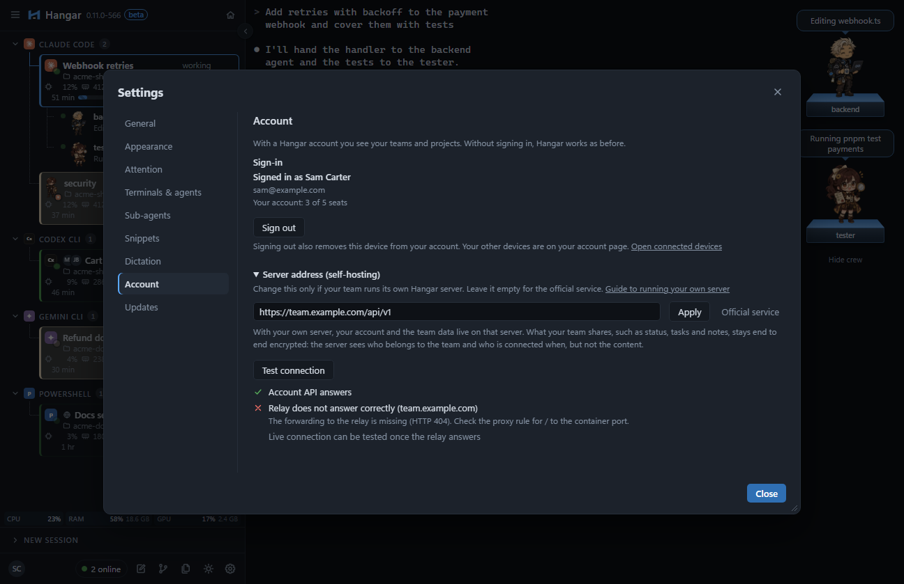
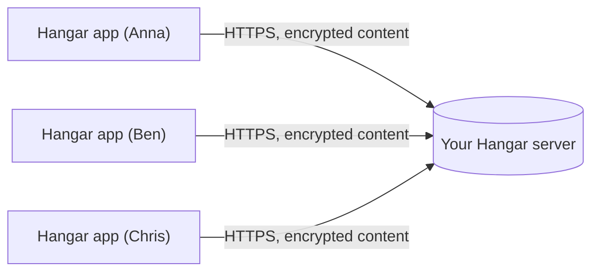

<p align="center">
  
</p>

<h1 align="center">Hangar Server</h1>

<p align="center"><strong>Your team's own server for Hangar. One command to install, end-to-end encrypted.</strong></p>

<p align="center">
  <a href="https://hangar.feoren.com">Website</a> ·
  <a href="#quick-start">Quick start</a> ·
  <a href="#step-by-step">Step by step</a> ·
  <a href="#faq">FAQ</a> ·
  <a href="#documentation">Documentation</a> ·
  <a href="https://github.com/feoren/hangar-server/releases/latest">Releases</a>
</p>

<p align="center">
  <a href="https://github.com/feoren/hangar-server/actions/workflows/ci.yml"></a>
  <a href="https://github.com/feoren/hangar-server/releases/latest"></a>
  <a href="https://github.com/feoren/hangar-server/pkgs/container/hangar-server"></a>
  <a href="LICENSE"></a>
</p>

[Hangar](https://github.com/feoren/hangar) is the desktop app for running AI coding agents as a
team. This server connects the Hangar apps of your team: who is working on what right now, who
has reserved which task, which files an agent is changing, plus shared notes. Everything your
team shares is encrypted on the device, so the server only stores and passes on data it cannot
read.

## Do I need this?

**Usually not.** Out of the box, Hangar uses the official service at
[hangar.feoren.com](https://hangar.feoren.com), where there is nothing to set up. Run your own
server when your team's data should stay on a machine you control.

| | Official service | Your own server |
| --- | --- | --- |
| Setup | none, just sign in | about 30 minutes, one command |
| Where the data lives | hangar.feoren.com | your server |
| Updates and backups | done for you | by you, one command each |
| Cost | see [pricing](https://hangar.feoren.com/pricing) | your server; for one person free, teams need a license |
| Content readable by the operator | no | no |

## Quick start

For anyone who has set up a Linux server before. On a fresh Debian or Ubuntu server whose
domain already points to it, with ports 80 and 443 open:

```sh
curl -fsSL https://github.com/feoren/hangar-server/releases/latest/download/install.sh | sudo sh
```

The script asks for your domain, your e-mail address and a team name, sets up HTTPS, creates
your first team and prints your sign-in link. Then enter `https://<your domain>/api/v1` in
Hangar under Settings › Account. New to servers? Follow the steps below.

## Step by step

No programming skills needed. Plan for about half an hour. Click a step to open it.

**What you need**

- A small Linux server with Debian or Ubuntu. Rent one from any hosting provider as a "VPS" or
  "cloud server"; the smallest plan with 1 GB of memory is enough. The provider gives you its
  IP address (such as `203.0.113.10`) and a password for the user `root`.
- A domain or subdomain for it, such as `team.example.org`.
- Your own computer with Windows, macOS or Linux. Nothing else to install.

<details>
<summary><strong>Step 1: Point your domain to the server</strong></summary>
<br>

At the provider of your domain, open the DNS settings and add a new record:

| Type | Name | Value |
| --- | --- | --- |
| `A` | `team` (the first part of your subdomain) | the IP address of your server |

It usually takes effect within a few minutes. Check it in a terminal on your computer (step 2
shows how to open one); the last lines must show your server's IP address:

```sh
nslookup team.example.org
```

If your server provider has a firewall in its customer area, open ports 22, 80 and 443 there.

</details>

<details>
<summary><strong>Step 2: Sign in to the server</strong></summary>
<br>

Open a terminal: PowerShell on Windows, Terminal on macOS. Type this, with your server's IP
address, and press Enter:

```sh
ssh root@203.0.113.10
```

1. Type `yes` when it asks whether you trust the server.
2. Type the password from your provider. It stays invisible while you type; that is normal.

Everything you type from now on runs on the server. `exit` signs you out.

</details>

<details>
<summary><strong>Step 3: Install the team server</strong></summary>
<br>

Paste this command (right click in PowerShell, Cmd+V on macOS) and press Enter:

```sh
curl -fsSL https://github.com/feoren/hangar-server/releases/latest/download/install.sh | sudo sh
```

It asks four questions:

| Question | What to answer |
| --- | --- |
| Domain | your domain without `https://`, such as `team.example.org` |
| E-mail address | your own address; you sign in with it and become the team admin |
| Team name | any name, or just Enter for `Team` |
| `docker` or `native` | just Enter; the suggestion fits your server |

If it offers to install Docker or Caddy, answer `y`. A few minutes later it prints `Done`, the
server address for Hangar and your sign-in link. Keep the window open.

If it stops with an error, fix the cause it names and run the same command again; it continues
where it stopped. See also [Troubleshooting](#troubleshooting).

</details>

<details>
<summary><strong>Step 4: Connect Hangar</strong></summary>
<br>

1. In Hangar, open **Settings › Account** and enter your server address under **Server
   address**: your domain with `https://` in front and `/api/v1` at the end, such as
   `https://team.example.org/api/v1`.
2. Click **Apply**, then **Test connection**. Every check should get a green tick; if not,
   Hangar names the cause.
3. Click **Sign in**. Hangar shows a short code.
4. Open your sign-in link from step 3 in the browser and confirm the same code.

<picture>
  <source media="(prefers-color-scheme: light)" srcset="docs/images/hangar-server-check-light.png">
  
</picture>

<sub>Test connection checks every part of your server and names the cause when one is missing.</sub>

The sign-in link works once and for one hour. Get a new one on the server with the line for
your way (the install script showed you which one applies):

```sh
cd /opt/hangar-server && docker compose run --rm server login-link you@example.org   # docker
sudo hangar-server login-link you@example.org                                        # native
```

</details>

<details>
<summary><strong>Step 5: Invite your team</strong></summary>
<br>

On the server, with the person's e-mail address:

```sh
cd /opt/hangar-server && docker compose run --rm server invite Team anna@example.org   # docker
sudo hangar-server invite Team anna@example.org                                        # native
```

- The command prints an invitation link. Send it to the person by e-mail or chat; it works
  once, for 7 days and only for that address.
- The person opens the link, then enters the same server address in Hangar and signs in.
- Add `admin` at the end to give someone admin rights. If your team has a different name, use
  it instead of `Team`, in double quotes if it contains spaces.
- `teams` instead of `invite ...` lists all teams and open invitations.

</details>

## What the server sees



Each Hangar app encrypts what your team shares before it leaves the device. The server passes
it on and stores it, but holds no keys.

| The server sees | The server never sees |
| --- | --- |
| who belongs to which team, and their devices | tasks and notes |
| who is connected, and when | file paths and changed lines |
| presence (active, idle, away) | status texts, decisions, transcripts |
| that two people work on the same file, as hashes | which file it is |
| team names (they appear in invitations) | |

The full list is in [docs/security.md](docs/security.md).

> [!NOTE]
> The encryption scheme is Hangar's own protocol and has not been externally audited yet.
> Please read [docs/security.md](docs/security.md) before using it with sensitive data.

## Requirements

| | |
| --- | --- |
| System | Linux, 64-bit (x86_64 or ARM64); the install script supports Debian and Ubuntu |
| Memory | 512 MB free; about 2 MB per connected device plus 64 MB |
| Network | a domain pointing to the server, ports 80 and 443 open |
| Software | nothing; the script installs Docker or runs the server as a system service |

## Running your server

**Teams need a license.** Without a license, the server runs for one person (private use):
you alone, with all your devices. To work with others, buy a Team plan with the seats you need
on [hangar.feoren.com](https://hangar.feoren.com/pricing), then:

1. Download the license file in your account under "Licence for your own server".
2. Copy it to the server, from a terminal on your computer (with your file name and IP address):
   `scp hangar-license-2026-11-17.txt root@203.0.113.10:~/`
3. Install it on the server:

   ```sh
   cd /opt/hangar-server && docker compose run --rm -T server license - < ~/hangar-license-2026-11-17.txt   # docker
   sudo hangar-server license - < ~/hangar-license-2026-11-17.txt                                         # native
   ```

**Updates.** Run the install command from step 3 again. It keeps data and settings, only
replaces the program and migrates the database. Hangar reconnects on its own.

**Backups.** All data lives in the Docker volume `hangar-server_team-data` (native:
`/var/lib/hangar-server`). Back it up regularly, for example once a week, as shown in
[docs/operations.md](docs/operations.md), and keep the copy on another machine.

**Mail.** Optional. Without it, the server prints invitation and sign-in links for you to pass
on. To send them by mail, fill in the `SMTP_*` lines in `/opt/hangar-server/.env` (native:
`/etc/hangar-server/.env`), set `MAIL_TRANSPORT=smtp` and restart the server.

## Troubleshooting

<details>
<summary><strong>The script says "does not resolve yet"</strong></summary>
<br>

The DNS record from step 1 is missing or not active yet. Check it with
`nslookup team.example.org`, wait a little and run the install command again.

</details>

<details>
<summary><strong>No HTTPS certificate, or the address does not load</strong></summary>
<br>

Usually a firewall at your provider blocks ports 80 and 443, or the DNS record points to a
different IP address. Open the ports, correct the record and run the install command again.

</details>

<details>
<summary><strong>Port 80 or 443 is already in use</strong></summary>
<br>

A web server already runs on this machine. Use a fresh server, or put Hangar behind your
existing web server as described under [Other ways to run it](#other-ways-to-run-it).

</details>

<details>
<summary><strong>Is my server running?</strong></summary>
<br>

Open `https://team.example.org/health` in the browser; it shows `{"status":"ok",...}`. In
Hangar, **Test connection** under Settings › Account checks every part. The latest log lines:

```sh
cd /opt/hangar-server && docker compose logs --tail 50 server   # docker
sudo journalctl -u hangar-server -n 50                          # native
```

</details>

Still stuck? Ask in the [Hangar discussions](https://github.com/feoren/hangar/discussions) and
include the error message.

## FAQ

<details>
<summary><strong>Do I need Docker?</strong></summary>
<br>

No. On a server without Docker, the install script suggests `native` and runs the server as a
system service. With Docker installed, it suggests `docker`. Both work the same for you.

</details>

<details>
<summary><strong>What does it cost?</strong></summary>
<br>

The server software is free for one person (private use). You pay your hosting provider for
the server (the smallest plan is enough) and, as soon as others should join, a Team plan with
seats on [hangar.feoren.com](https://hangar.feoren.com/pricing). If a license runs out, nothing
is deleted and nobody loses access: everyone who already joined keeps working, only new people
cannot join until the license is renewed.

</details>

<details>
<summary><strong>Can I run it without a domain?</strong></summary>
<br>

Not for a team. Outside your own computer, Hangar only connects via `https`, and the
certificate for that needs a domain. A subdomain of a domain you already own is enough.

</details>

<details>
<summary><strong>Do I need a mail server?</strong></summary>
<br>

No. The server prints invitation and sign-in links, and you pass them on yourself. You can add
mail later, see [Running your server](#running-your-server).

</details>

<details>
<summary><strong>How do I remove the server?</strong></summary>
<br>

Back up the data first if you might need it again. This deletes the server and all its data.

Docker:

```sh
cd /opt/hangar-server && docker compose down --volumes
cd / && sudo rm -rf /opt/hangar-server
```

Native:

```sh
sudo systemctl disable --now hangar-server
sudo rm -f /etc/systemd/system/hangar-server.service /usr/local/bin/hangar-server
sudo rm -rf /usr/local/lib/hangar-server /etc/hangar-server /var/lib/hangar-server
sudo userdel hangar-server
sudo systemctl daemon-reload
sudo rm -f /etc/caddy/hangar-server.caddy
sudo sed -i '\|import /etc/caddy/hangar-server.caddy|d' /etc/caddy/Caddyfile
sudo systemctl reload caddy
```

Caddy itself stays installed; remove it with `sudo apt remove caddy` if nothing else uses it.

</details>

## Other ways to run it

For administrators who prefer to fit the server into an existing setup.

<details>
<summary><strong>Docker Compose or Portainer stack</strong> (Docker host with ports 80 and 443 free)</summary>
<br>

```sh
mkdir -p /opt/hangar-server && cd /opt/hangar-server
curl -fsSLO https://github.com/feoren/hangar-server/releases/latest/download/docker-compose.yml
printf 'PUBLIC_URL=https://team.example.org\nSERVER_SECRET=%s\n' "$(openssl rand -hex 32)" > .env
chmod 600 .env
docker compose up -d
docker compose run --rm server create-team you@example.org Team
docker compose run --rm server login-link you@example.org
```

`PUBLIC_URL` is your address without a trailing slash; Docker Compose 2.24 or newer is needed.
The file starts the server with Caddy for HTTPS and needs nothing else. In Portainer, paste it
as a stack and set `PUBLIC_URL` and `SERVER_SECRET` as variables. To update, set
`HANGAR_VERSION` in `.env` and run `docker compose pull && docker compose up -d`.

</details>

<details>
<summary><strong>Image only</strong> (you already have a reverse proxy with HTTPS)</summary>
<br>

```sh
docker run -d --name hangar-server --restart unless-stopped -p 127.0.0.1:8080:8080 \
  -v hangar-data:/data -e IDENTITY=local -e PUBLIC_URL=https://team.example.org \
  -e SERVER_SECRET="$(openssl rand -hex 32)" -e TRUST_PROXY=true \
  ghcr.io/feoren/hangar-server:0.6.1
```

Forward the domain to `http://127.0.0.1:8080` and allow WebSocket upgrades with long timeouts.
The proxy must set `X-Forwarded-For` to the client address itself (nginx:
`proxy_set_header X-Forwarded-For $remote_addr;`); otherwise clients can bypass the limits per
address.
Server commands then start with `docker exec hangar-server hangar-server`, for example
`docker exec hangar-server hangar-server create-team you@example.org Team`. To update, create
the container again with the new tag; the volume `hangar-data` stays.

</details>

## Documentation

| Topic | File |
| --- | --- |
| Operations in detail: configuration, backups, restarts, official service | [docs/operations.md](docs/operations.md) |
| All settings with explanations | [.env.example](.env.example) |
| Security and threat model | [docs/security.md](docs/security.md) |
| All HTTP routes | [docs/http-api.md](docs/http-api.md) |
| Account API for the app | [docs/account-api.md](docs/account-api.md) |
| Protocol of the live channel | [docs/protocol.md](docs/protocol.md) |
| Code, building, tests, crates from the app | [docs/development.md](docs/development.md) |

## Getting help and contributing

- **Questions and problems:** [Hangar discussions](https://github.com/feoren/hangar/discussions)
- **Bugs in the server:** [open an issue](https://github.com/feoren/hangar-server/issues/new/choose)
- **What changed:** [release notes](https://github.com/feoren/hangar-server/releases)
- **Teams and seats:** [contact](https://hangar.feoren.com/contact?topic=teams)
- **Building and testing the code:** [docs/development.md](docs/development.md)

## License and security

[Elastic License 2.0](LICENSE): using, modifying and self-hosting for your own team are allowed.
Offering the server as a hosted service to others, or circumventing the seat and license check,
is not.

Please do not report security vulnerabilities publicly; follow [SECURITY.md](SECURITY.md)
instead.
